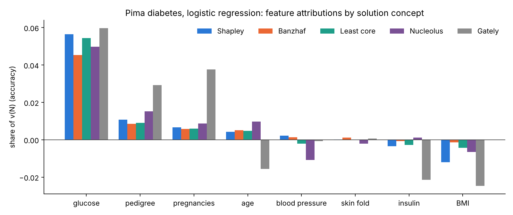

# Cooperative Game Theory for Explainable AI

This repository contains the code for a project at the Game Theory Lab, IISc, on feature attribution and data valuation with cooperative game theory. An early version was presented at the Foundations of Ethical AI workshop (IIIT Hyderabad).

A model's performance on a subset of features (or training points) defines a coalitional game, and each solution concept of that game is a different way to explain the model. Most XAI work uses only the Shapley value. This project asks what the other classical concepts (least core, nucleolus, Gately point, power indices) say about the same model, how they behave when features are causally related, and how faithful and robust each one is.



*Pima diabetes, logistic regression. v(S) is the test accuracy on feature subset S above the majority-class baseline, and every concept splits v(N) among the features. The concepts agree on the dominant feature (glucose) but differ sharply on the weaker ones. On a 154-sample test set, features that add little can have negative shares. Reproduce with `python examples/feature_attribution.py`.*

## The Library

`cgt_xai/` is an installable package.

| Module | Contents |
| --- | --- |
| `concepts.shapley` | exact and Monte Carlo Shapley value |
| `concepts.banzhaf`, `concepts.shapley_shubik`, `concepts.deegan_packel` | power indices |
| `concepts.least_core`, `concepts.nucleolus` | LP/QP-based core solutions (CVXPY) |
| `concepts.gately_point` | Gately point (minimizes the maximum propensity to disrupt) |
| `concepts.data_valuation` | leave-one-out, TMC-Shapley, group-testing Shapley |
| `concepts.causal_shap` | Causal SHAP: PC discovery, DAG sampling from the CPDAG, interventional Shapley values |
| `causal_asv` | asymmetric Shapley values that follow a causal ordering |
| `causal_shap_robustness` | robustness of Causal SHAP to graph and data perturbations |
| `models` | model factory (logistic regression, random forest, SVM, GRU/LSTM) |

Every solver takes a `utility` callable that maps a list of player indices to a value, so the same code values features, data points or any other players.

```python
from cgt_xai.concepts.shapley import exact_shapley_value
from cgt_xai.concepts.least_core import exact_least_core

phi = exact_shapley_value(utility).values
lc = exact_least_core(utility)      # lc.values, lc.subsidy (the least-core epsilon)
```

## Repository Structure

- **cgt_xai/**: the library described above.
- **experiments/**: one folder per question, listed below.
- **feature_data_valuation/**: the first stage of the project, with its own earlier implementation of the concepts.
- **examples/**: a short script that reproduces the figure above.
- **datasets/**: preprocessed datasets as `.npz` files.
- **tests/**: checks of every concept on games with known answers.

## Experiments

| Folder | Question |
| --- | --- |
| `experiments/local_explanation/` | local explanations with loss-based and conditional-expectation utilities (wine, soil, yield, COMPAS, credit, diabetes) |
| `experiments/feature_valuation/` | global feature valuation across concepts and datasets |
| `experiments/allocations/` | least core, Gately and Shapley allocations with accuracy and log-loss utilities |
| `experiments/metrics/` | faithfulness and robustness of each concept (Quantus and custom metrics), including LSTM and RNN models |
| `experiments/causal_shap/` | Causal SHAP on soil and yield data; graph and edge-weight sensitivity |
| `experiments/causal_discovery/` | Causal SHAP with graphs from DAGMA / DAGMA-DCE, DrBO and ALIAS |
| `experiments/asymmetric_shapley/` | asymmetric Shapley values on lung cancer and cardiovascular risk data |
| `experiments/lung_cv_risk/`, `experiments/soil/`, `experiments/myerson/` | per-dataset comparisons, scalability, Myerson value with a feature graph |
| `feature_data_valuation/` | the project's first stage: feature and data valuation on UCI datasets, with its own earlier implementation of the concepts |

Preprocessed datasets are in `datasets/` and `feature_data_valuation/datasets/` as `.npz` files. Raw CSVs (cardiovascular and lung cancer risk, FAO data) are not included.

## Setup

```bash
pip install -r requirements.txt
pip install -e .
python -m pytest tests -q
```

The tests check every concept on games with known answers (glove game, majority game, additive and symmetric games). The causal discovery notebooks also need two external packages:

```bash
git clone https://github.com/DanWaxman/DAGMA-DCE && pip install -e DAGMA-DCE/src
cd experiments/causal_discovery/drbo && ./setup_drbo.sh
```
